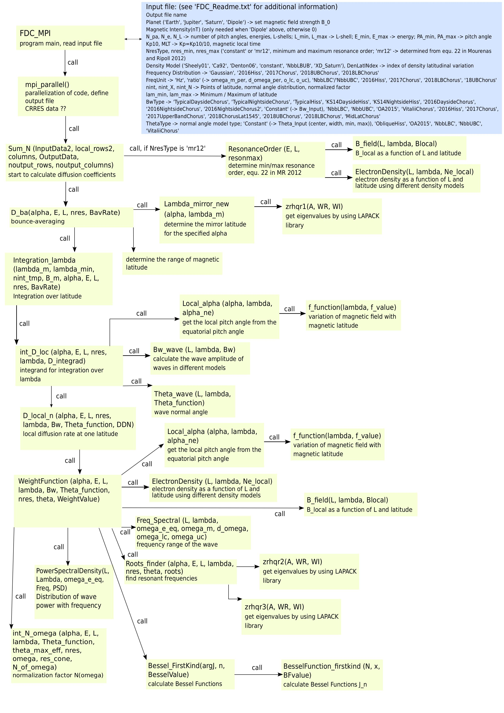

# How to Add New Models to Full Diffusion Code?

Full Diffusion Code (FDC; [Ni et al., 2008](https://doi.org/10.1029/2008gl034032); [Shprits and Ni, 2009](https://doi.org/10.1029/2009ja014223); [Orlova and Shprits, 2011](https://doi.org/10.1063/1.3638137)) is used to calculate the quasi-linear bounce-averaged diffusion coefficients using a dipole magnetic field in the form given by [Glauert and Horne (2005)](https://doi.org/10.1029/2004JA010851).

The equations used to calculate local diffusion coefficients can be found [here](docs/equations.md).

## Inputs

The inputs for FDC are stored as `.txt` files in the `Input` folder. More information on input files can be found [here](docs/input.md).

## Running

Before running FDC, you must load the mathematical packages and compile the Fortran code. This process differs on **MP machines** and **GLIC**. Instructions for both are available [here](docs/compile.md).

The code is run using a bash script. More details about the bash script for running FDC, how to execute it, and the outputs can be found [here](docs/bash.md).

## Pipeline and Modules

The FDC code is written in Fortran 90 and located in `Src/`. The pipeline is illustrated in the following diagram.

*Pipeline of FDC. Credits: Katja Stoll*

Descriptions of each module can be found [here](docs/modules.md).

## Adding New Models

This documentation covers adding whistler-mode waves and changing density models. All additions involve adding new switch cases to the respective `.f90` files.

> **GOLDEN RULE**: Any change you make must be reflected in [`FDC_MPI.f90`](docs/FDC_MPI.md), or the code will throw errors.

For whistler-mode waves, you might need to incorporate the following models:
- `Spatial Dependent Intensity`: Add the model to [`Bw_wave.f90`](docs/Bw_wave.md).
- `Frequency Dependent PSD`: Add the model to [`PowerSpectralDensity.f90`](docs/PowerSpectralDensity.md). Also add the upper and lower frequency cutoffs for the respective models to [`Freq_Spectral.f90`](docs/Freq_Spectral.md).

To change density models, edit [`ElectronDensity.f90`](docs/ElectronDensity.md).

---

This documentation is based on the document created by `Katja Stoll`, which can be found [here](docs/fdc_discription.pdf).
